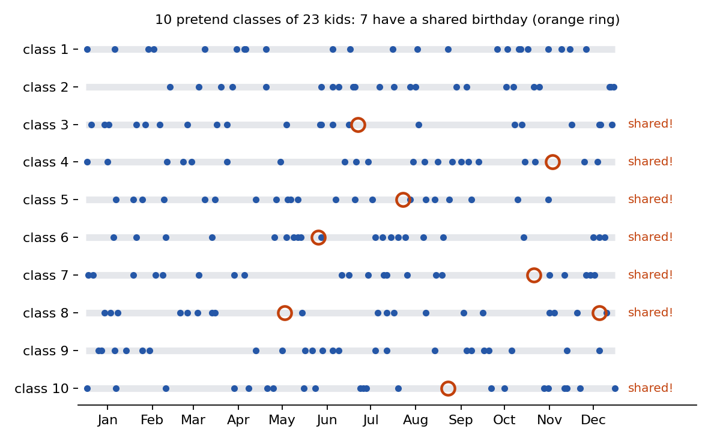
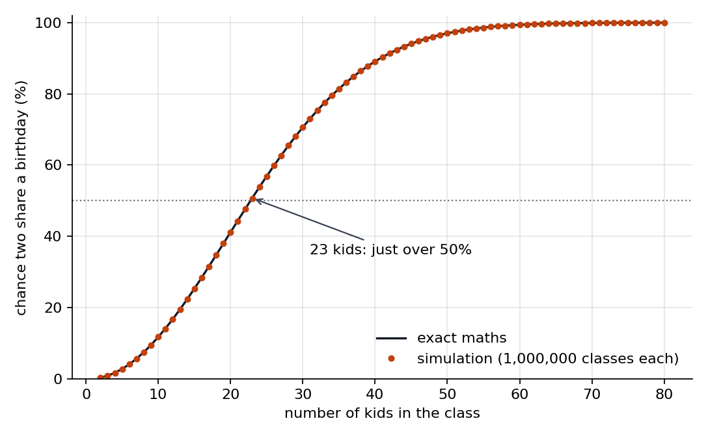

## The question

Imagine your class playing a birthday game. Everyone says their birthday. You win if any two kids name the same day and month. Their birth years do not matter.

How big does your class need to be before winning is more likely than losing?

A **chance** tells you how likely something is to happen. Another word for chance is **probability**. A percentage is a way to describe it using parts out of a hundred. A **50% chance** means about half the time, like a fair coin landing heads.

For our game, we give every day of a 365-day year the same chance. We leave out 29 February.

We want to find the chance of a shared birthday for different class sizes.

Here is the surprising answer: **with 23 kids, the chance is just over half.**

We can work out the answer using counting rules, without guessing or running pretend games. That is what **exact maths** means here. For 23 kids, its answer is **50.73%**, rounded for display.

That is the right answer for our game's rules. Now let's see whether a computer game gets close.

## Why such a small class can win

Picture yourself asking, “Does anyone share **my** birthday?” You have only your own birthday to check.

Now imagine everyone walking around the classroom, checking birthdays with everyone else. Two friends across the room could find a match even if neither shares yours.

That is why the answer feels surprising. **Any two kids can win the game for the whole class.**

A **pair** means two kids considered together. As more kids join, there are more pairs to check.

> [!INTUITION]
> Think about saying hello at a party. You can greet each person yourself. But if everyone greets everyone else too, there are many more greetings around the room. Birthday matches work a bit like that: every pair gets a chance to match.

You can also imagine kids joining a line. To keep every birthday different, each new kid must avoid all the birthdays already in the line. The longer the line gets, the harder that becomes.

## What we did

A **simulation** is a pretend experiment on a computer. Ours made pretend classes and checked their birthdays.

The computer chose birthdays **at random**. That means the choice was left to chance, like rolling a die or tossing a coin. You do not choose the result.

For our birthday game, imagine drawing a day from a bag containing every day of the year. You put the day back before drawing again. Every day stays equally likely, and a birthday can appear again.

Here is how we played:

1. Make a pretend class.
2. Give each kid a birthday chosen at random.
3. Check whether any two birthdays match.
4. Record whether the class won.
5. Repeat with lots of fresh classes.

We tried every class size from 2 to 80 kids. For each size, the computer played the game **{{result.classes_per_size}} times**.

Then we compared the share of games won with the exact maths answer.

> [!NOTE]
> **For grown-ups.** The Python program is in [`experiment.py`](experiment.py), and the results are in [`results.csv`](results.csv). It ran in a Delta cloud sandbox in about {{result.seconds}} seconds. The following excerpt checks for matching birthdays after sorting them.

@include experiment.py#L63-L65

## Results

First, peek at 10 pretend classes of 23 kids. Each row below is a class. The dots show birthdays across the year. An orange ring marks a shared birthday.

These classes are only a peek. To measure the chance more carefully, we used all the pretend classes.

Here are the computer's results beside the right answers for our rules. The exact maths answers are rounded to the same number of decimal places.

| Kids in the class | Simulation: chance of a match | Exact maths: chance of a match | How close? |
|---:|---:|---:|:---|
| 10 | 11.71% | 11.69% | Very close; slightly higher |
| 23 | 50.66% | 50.73% | Very close; slightly lower |
| 30 | 70.66% | 70.63% | Very close; slightly higher |
| 50 | 97.03% | 97.04% | Very close; slightly lower |
| 70 | 99.92% | 99.92% | The same at the precision shown |

At 10 kids, a match is still unusual. At 23, winning is about as likely as a coin landing heads. At 50, a match is very likely.

The picture below shows how the chance grows. The orange dots show our pretend games. The black line shows the exact maths answers.

Why do the table's answers differ a little? Our computer played games with birthdays chosen by chance. A fresh set of games could give slightly different results, just as a run of coin tosses need not contain equal numbers of heads and tails.

> [!TAKEAWAY]
> With just 23 kids, a shared birthday is more likely than no shared birthday under our rules. The computer's pretend games came very close to the exact maths answers.

## What this tells us—and what it doesn't

**The birthday surprise works under our rules.** A class does not need to be huge for a match to become likely. But “likely” is not a promise. Your own class might have no match.

**Real birthdays do not follow our rules perfectly.** Some days are more common birthdays than others. We gave every day the same chance. We did not measure the chance in real school classes.

**We left out 29 February.** Our answers belong to a calendar without leap-day birthdays.

**We chose each birthday separately.** Giving one pretend kid a birthday did not affect another kid's birthday. Real classmates can include twins who share a birthday.

**This was a check, not a new discovery.** The maths was already known. Our experiment showed that these pretend games gave results close to it.

You can try the birthday game with your class. Ask everyone for their day and month, then hunt for a match. Whatever happens, remember: your class is one game. The chance describes what we expect across many games.