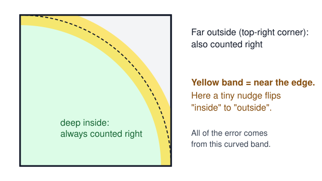

## The question

π (say "pie") is the number you get when you divide the distance around any circle by the distance across it. It starts 3.14159… and never ends. Here is a fun way to find the first few digits with nothing but darts.

Draw a square. Inside it, draw a quarter of a circle, like a slice of pizza that fills the square's corner. Now throw lots of darts at the square, without aiming. Count how many land on the pizza slice.

Why does this work? The slice takes up π ÷ 4 of the square, which is about 78.5%. So if your darts land all over the square fairly, about 78.5% of them land on the slice. Multiply the fraction you counted by 4, and out comes a guess for π.

This idea of "guess a number by trying lots of random things and counting" has a name: the **Monte Carlo method**, named after a famous casino. Scientists wrote it up in 1949 [@metropolis1949]. Today it helps forecast the weather, design aeroplanes, price things in banks and draw the lighting in animated films.

There is one problem. Random darts are a bit messy. Some bunch up together and leave empty gaps elsewhere. So we asked:

**What if we place the darts neatly and evenly, instead of randomly? How much better is the guess, even with a billion darts?**

## Two ways to throw darts

### Random darts

A random dart can land anywhere, like a real throw with your eyes closed. The more darts you throw, the better your guess, but it improves slowly.

> [!INTUITION]
> With random darts, to make your guess **10 times** more accurate you need **100 times** more darts. Mathematicians call this the "square root rule", because 10 is the square root of 100.

### Neat darts

Instead of throwing randomly, we can follow a recipe that puts each new dart into the biggest empty gap left so far. This is called a **Halton sequence**, invented by John Halton in 1960 [@halton1960]. Using neat darts instead of random ones is called **quasi-Monte Carlo** ("quasi" means "almost").

The recipe is a neat trick with number bases. To find dart number 6, write 6 in base 2 (the way computers count), flip the digits around the decimal point, and you get how far right the dart goes. Do the same in base 3 to get how far up.

Here is how the two kinds of darts look side by side, with 256 darts each. Filled dots landed on the slice, and hollow dots missed.

 and 256 neat darts (right), drawn by our program. The random ones clump and leave holes, while the neat ones cover the square evenly. With only 256 darts both happen to give the same guess; the difference shows up when you repeat this many times.")

> [!NOTE]
> **For grown-ups.** The guess is $\hat\pi_N = \frac{4}{N}\sum_{i=1}^{N}\mathbf{1}[x_i^2+y_i^2\le 1]$. In words: count the darts inside, divide by all $N$ darts, multiply by 4. For random darts the typical error is about $1.64/\sqrt{N}$. Theory for neat (low-discrepancy) points [@niederreiter1992] promises close to $1/N$, but only for smooth functions. "Inside or outside" jumps suddenly at the edge, so it is not smooth.

## What we did

We wrote a Python program, [`experiment.py`](experiment.py), that throws pretend darts on a computer. Checking whether a dart is inside the slice takes one line:

@include experiment.py#L56-L58

In words: a dart at position $(x, y)$ is inside if $x^2 + y^2$ is at most 1 (that is Pythagoras' rule for distance from the corner).

Here is the whole experiment:

1. **How many darts.** We started with 64 darts and kept doubling: 128, 256, … all the way to {{result.max_darts}} darts, which is just over a billion.
2. **Random darts.** For each number, we threw random darts 50 separate times and measured how far each guess was from the real π.
3. **Neat darts.** Neat darts always land in the same places, so repeating them would give the same answer 50 times. To make a fair test we slid the whole neat pattern by a random amount each time, wrapping around the edges like in a video game. The darts stay evenly spread. This trick is from Cranley and Patterson [@cranley1976].
4. **Scoring.** For each number of darts, we averaged how far off the 50 guesses were. Smaller is better.

A billion darts, 50 times over, for two kinds of darts, is about a **hundred billion** darts in total. That is far too many for a laptop, so we ran it on a graphics card (GPU) in a Delta cloud sandbox (see the Reproduce box at the end). A GPU can check millions of darts at the same moment. Our program handles the darts in batches of about 16 million, so they never all need to fit in memory at once. The whole run took {{result.seconds}} seconds on an {{result.device}}. All the numbers are in [`results.csv`](results.csv).

## Results

Neat darts won every time, and their lead kept growing as we threw more darts:

| Number of darts | Random darts: average miss | Neat darts: average miss | Neat darts are better by |
|---:|---:|---:|---:|
| 64 | 0.14 | 0.088 | 1.6× |
| 4,096 | 0.019 | 0.0033 | 5.8× |
| 262,144 | 0.0026 | 0.00015 | 17.5× |
| 16,777,216 | 0.00034 | 0.0000053 | 65× |
| 1,073,741,824 | 0.000039 | 0.00000026 | 148× |

What does that mean for π itself? The real π starts 3.1415927. With a billion random darts, a typical guess was off by about 0.00004, something like 3.14163: only the first **5** digits right. With a billion neat darts, a typical guess was off by about 0.0000003, something like 3.1415930: the first **7** digits right.

> [!TAKEAWAY]
> Placing the darts neatly made the guess about {{result.better_by_1b}} times more accurate at a billion darts, for free. But it improved more slowly than the textbook promise, because of the circle's curved edge.

### How fast does each one improve?

Scientists like to check how quickly the error shrinks as you add darts. This chart uses special "log" scales, where each big step along an axis means 10 times bigger. On these scales, a steeper line means faster improvement.

. Orange: neat darts, falling faster but not as fast as the textbook promise (dotted orange).")

What we noticed:

1. **Random darts behaved exactly as expected.** Their line has a slope of {{result.slope_random}}, very close to the −0.5 that the square root rule predicts.
2. **Neat darts improved faster.** Their slope is {{result.slope_halton}}. In everyday terms, to make the guess 10 times more accurate you need about 20 times more neat darts, instead of 100 times more random darts.
3. **But not as fast as the textbook says.** The textbook promise for neat points is a slope close to −1, which would mean 10 times more darts for 10 times more accuracy. The gap between the orange line and the dotted orange line keeps growing all the way to a billion darts.

## Why the edge slows things down

Think about which darts can ever be counted "wrong". A dart deep inside the slice is clearly inside, and a dart in the far corner is clearly outside. Only darts very close to the curved edge are tricky: a tiny nudge could flip them from "in" to "out".

Neat darts are arranged in a very even, grid-like way, but a grid of straight rows and columns can never match a curve perfectly. So the curved edge always leaves some leftover error.

Mathematicians have worked this out properly. He and Wang [@he2015] studied exactly this kind of "inside or outside" problem. Their result predicts a slope of −0.75 for a shape in 2D, and we measured {{result.slope_halton}}.

> [!NOTE]
> **For grown-ups.** He and Wang show that for randomized quasi-Monte Carlo on certain indicator functions in $d$ dimensions, the root-mean-square error is $O(N^{-1/2-1/(2d)})$, which is $O(N^{-3/4})$ when $d=2$. We report the mean absolute error, which should shrink at the same rate but with a different constant.

## What this does (and doesn't) show

- **One shape, flat on paper.** We only tried a quarter circle in 2D. Smooth problems with no sharp edges would probably let neat darts get closer to the textbook promise. Problems in many more dimensions would probably be harder. We did not test either.
- **Close to the theory, not a proof.** Our {{result.slope_halton}} matches the −0.75 that He and Wang's work predicts, but we did not check that our exact setup meets every condition in their paper.
- **Slopes are rough.** We fitted a straight line through 25 points. The first few points are noisy, and the slope moves by a few hundredths depending on which points you include.
- **The 256-dart picture is just one try.** In that picture both kinds of darts happen to give the same guess. The real comparison is the average over 50 tries in the table above.
- **Very small numbers.** At a billion darts the neat guesses are off by about 0.0000003. We used 64-bit numbers (about 16 digits), which is plenty for that, but we did not separately test how rounding inside the computer affects the very last points.
