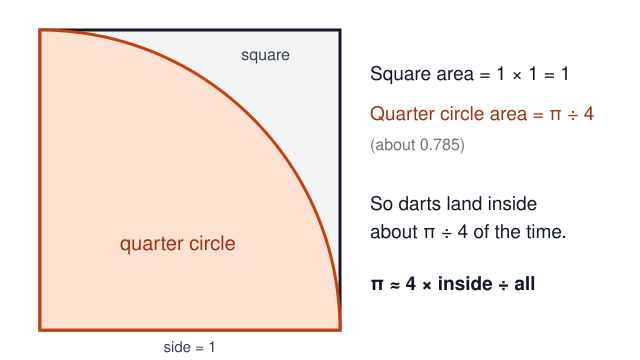
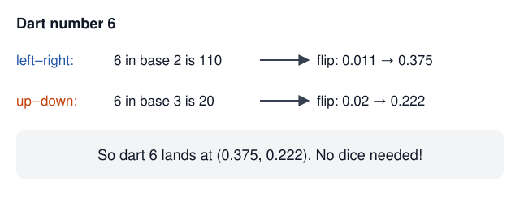
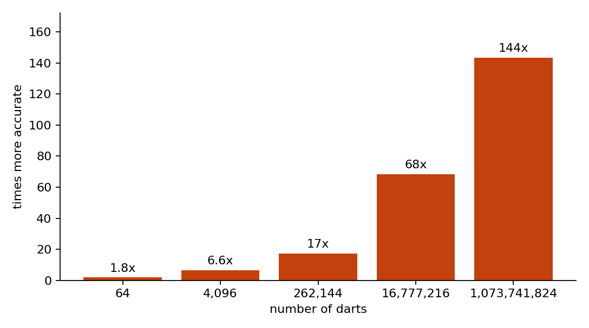
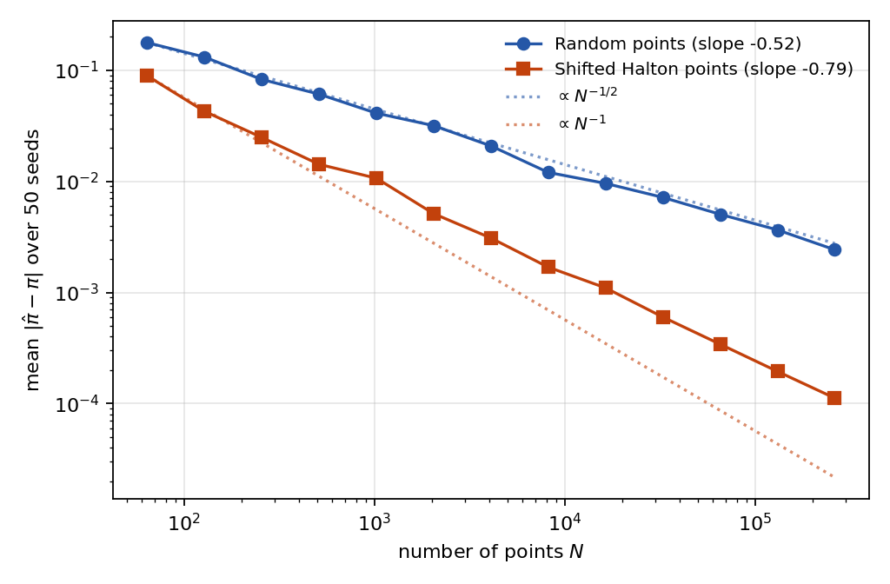

## The question

Every circle shares a special number called **pi**, written π. Say it like “pie”. Divide the distance around a circle by the distance straight across its middle, and you get pi.

Its digits go on forever. But you can guess its size with a drawing and some dots.

Draw a square. In one corner, draw a quarter circle: one of four equal slices of a circle. Make its straight sides reach along two sides of the square.

Now imagine dropping tiny paper dots onto your drawing.

Most dots should land inside the slice. Some should land outside.

Here is the trick. Count the dots inside the slice. Divide that count by the total number of dots. Then multiply your answer by four. You have a guess for pi!

This works because the share of dots inside tells you roughly how much of the square the slice covers. Every part of the square must have a fair chance of catching a dot.

Scientists call this kind of chance-based guessing a **Monte Carlo method** [@metropolis1949].

But chance can be messy. Dots may bunch up and leave gaps.

**Could carefully spread dots give you a closer guess?**

## Meet the two teams

Our dots are pretend darts. No sharp points needed!

**Team Random** puts each dart somewhere chosen by chance. It does not check where earlier darts landed.

**Team Halton** follows a recipe that spreads darts across the square. A **Halton sequence** is this ordered list of dart positions. It is named after John Halton [@halton1960].

It does not hunt for the biggest gap. Instead, it rearranges the digits of each dart’s number to choose a spot.

The next picture shows the number trick. You can skip the details and still follow our experiment.

Look at the teams below. Can you spot clumps and empty patches?

Filled dots landed inside the slice. Hollow dots landed outside.

 and Team Halton (right), 256 darts each, drawn by our program. The random darts clump and leave holes. The Halton darts cover the square evenly.")

Surprise: these two pictures give the same guess! A tidy-looking picture alone cannot tell us which team usually does better.

We need more games.

## What we did

An AI called Claude wrote a program in Python, a language for giving computers instructions. The program, [`experiment.py`](experiment.py), placed darts and checked which landed inside the slice.

Here is the part that checks each dart. You do not need to read computer code to follow the story.

@include experiment.py#L56-L58

We started with 64 darts. Then we doubled the number again and again, ending with just over a billion. A billion is a thousand million!

At each size, each team played 50 games.

For Team Random, the computer chose fresh positions each time.

Team Halton needed a different trick. Its recipe always gives the same pattern. So we slid the pattern by a randomly chosen amount before each game. Darts that slid off one edge came back through the opposite edge, like characters in some video games [@cranley1976].

For each guess, we measured the **error**: how far it was from pi. Then we found each team’s average error across its games. A smaller error wins.

A **GPU**, a computer chip that can do many checks at once, ran the experiment in Delta, a service for running programs on distant computers.

> [!NOTE]
> **For grown-ups.** The largest sample contained {{result.max_darts}} darts per trial. The run took {{result.seconds}} seconds on an {{result.device}}. The recorded errors are mean absolute errors across 50 trials. Data: [`results.csv`](results.csv).
>
> The estimator is $\hat\pi_N = \frac{4}{N}\sum_{i=1}^{N}\mathbf{1}[x_i^2+y_i^2\le 1]$. Random sampling has a typical error proportional to $N^{-1/2}$. Quasi-Monte Carlo uses evenly distributed points; its guarantees depend on the integrand and point construction [@niederreiter1992].

## Results

Team Halton had the smaller average error at every number of darts we tested.

Its lead grew as the games got bigger.

At the smallest size, the difference was modest. At about a billion darts, Team Halton’s average miss was about {{result.better_by_1b}} times smaller.

That compares the teams’ average misses. It does not mean every Halton guess beat every random guess.

> [!TAKEAWAY]
> Spreading the darts carefully gave much closer guesses in this experiment. The way you choose your dots can matter a lot!

> [!NOTE]
> **For grown-ups.** At 262,144 darts, random sampling had mean absolute error {{result.random_error_262k}}, versus {{result.halton_error_262k}} for shifted Halton points: a factor of {{result.better_by_262k}}.
>
> At the largest sample, the errors were {{result.random_error_1b}} and {{result.halton_error_1b}}, respectively: a factor of {{result.better_by_1b}}.

### Did more darts always help?

Think of error as a distance you want to shrink.

The next chart tracks that distance as we add darts. Lower means a closer guess.

The chart squeezes huge numbers into a small space. Each large step along a scale means ten times as much. Scientists call this a **log scale**.

Both teams improved overall. Team Halton improved faster.

But there is a catch in that picture. The dotted orange line shows a faster pace that neat points can approach in suitable problems. It is not a promise for every problem.

Our circle game did not improve that quickly.

## The tricky edge

Imagine nudging a dart.

If it is deep inside the slice, a tiny nudge leaves it inside. Far outside, it stays outside.

Near the curved edge, the same nudge might change the answer.

 can tip from inside to outside. Darts deep inside or far outside are always counted the same way. {diagram}")

The computer still follows a clear rule for counting each dart. The difficulty is making the whole set of dots represent the slice fairly.

An “inside or outside” answer changes suddenly at the edge. That makes this game harder than problems where the answer changes gently.

The picture gives you an idea of the difficulty. Halton dots do not actually form ordinary rows and columns, and our experiment did not prove that the curve alone caused the pace we saw.

Researchers He and Wang studied related problems with sudden changes [@he2015]. Their work offers a useful clue.

> [!NOTE]
> **For grown-ups.** Fitted log-log slopes were {{result.slope_random}} for random sampling and {{result.slope_halton}} for shifted Halton sampling.
>
> He and Wang establish root-mean-square error rates of $O(N^{-1/2-1/(2d)})$ under particular assumptions and randomized constructions. In two dimensions this is $O(N^{-3/4})$. Our fitted slope is numerically close to that exponent, but we have not established that the theorem applies to this exact construction. We measured mean absolute error, not root-mean-square error. A fitted slope is not a proof of a convergence rate.

## What can you trust?

**This game had a clear winner.** Carefully spread darts gave smaller average misses at every size we tested.

**We tried only one shape on a flat square.** Other shapes, other recipes and other kinds of puzzles could behave differently. We did not test them.

**A trend is a clue, not a rule for forever.** Our lines describe the sizes we tried. Choosing a different part of the chart can change their measured steepness.

**Computers round numbers too.** We used numbers with room for many digits, but did not separately test whether tiny rounding effects changed the last few results.

And remember the first pair of dot pictures? They tied. That is why we repeated the game.

You can try the paper version yourself. Place dots by chance, then try spreading them carefully. Count, compare and wonder. Your drawing will not settle the whole question—but it can help you see why scientists ask it.