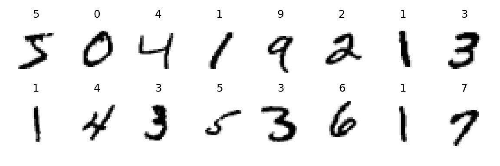
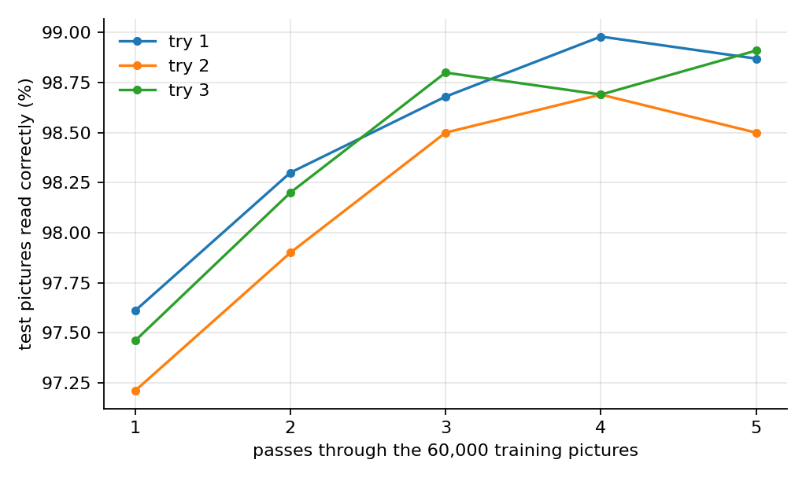
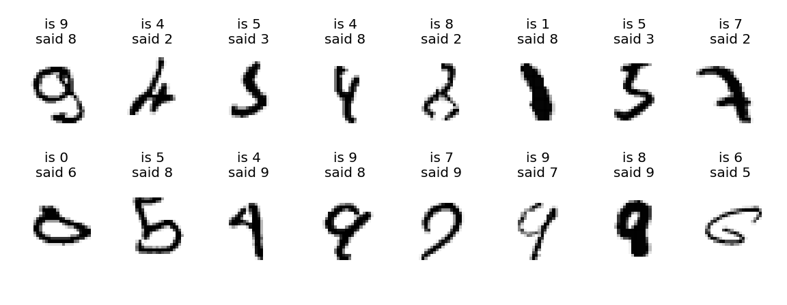
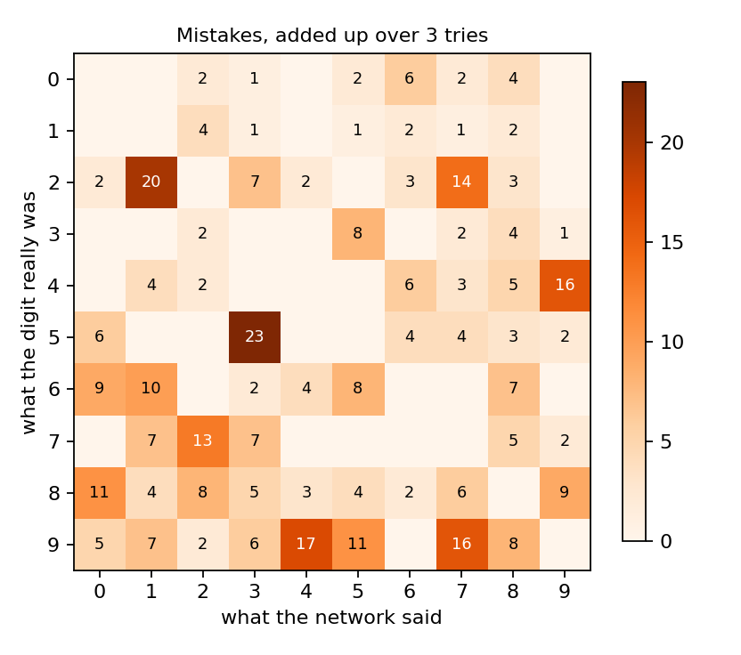

## The question

How do you know a "7" is a 7? You've seen thousands of them, written by different people in different ways, and somewhere along the way you just learned.

Now try to write down **rules** for a computer: "a 7 has a flat line at the top and a slanted line going down". Then someone writes a 7 with a little cross through the middle, or a curly top, and your rule breaks. Handwriting is too messy for rules.

So computer scientists tried a different idea: **don't give the computer rules, give it examples**, and let it work out the rules for itself. This is called **machine learning**. We wanted to see how well it works with a small program and a set of handwritten digits.

## How a computer can learn from examples

We use a **neural network**, a program loosely inspired by how brain cells connect. Ours has about {{result.parameters}} adjustable numbers inside it, a bit like the knobs on a giant mixing desk.

> [!INTUITION]
> Imagine a game of "hot and cold". The network looks at a picture and guesses a digit. If the guess is wrong, every knob gets nudged a tiny bit in the direction that would have made the right answer more likely. Do that tens of thousands of times and the knobs end up in positions that read handwriting well. Nobody sets the knobs by hand.

Our network has two kinds of layers:

1. **Pattern finders** (called *convolutional* layers). They slide a tiny 3 × 3 window over the picture, looking for simple shapes such as short strokes, curves and corners, wherever they appear. A second pattern-finder layer combines those into bigger shapes like loops and crossings.
2. **Deciders** (ordinary layers). They take all the shapes found and give a score to each digit from 0 to 9. The highest score is the network's answer.

This design, pattern finders followed by deciders, was made famous by Yann LeCun and colleagues, who used it to read handwritten numbers on bank cheques [@lecun1998].

## What we did

**The digits.** We used **MNIST**, a famous collection of handwritten digits made by the same team [@lecun1998]. It has 60,000 practice pictures and 10,000 test pictures, each 28 × 28 pixels, every one labelled with the right answer.

**The practice.** The network practised on the 60,000 practice pictures in small batches of 128. After each batch it nudged its knobs using a method called Adam [@kingma2014]. One trip through all 60,000 pictures is called an **epoch**; we did {{result.epochs}} of them.

Here is the heart of the practice loop, from [`experiment.py`](experiment.py):

@include experiment.py#L121-L126

In words: pick a batch of pictures, see how wrong the network's answers are (the "loss"), work out which way to nudge every knob, and nudge them.

**The test.** After every epoch we tested the network on the 10,000 test pictures. It **never** practises on these, so they show how well it reads handwriting it has never seen, like a surprise spelling test.

**Fair comparison.** A network starts with random knob positions, so we trained 3 separate networks from 3 different random starts and report the average.

**Where it ran.** We ran it on a GPU in a Delta cloud sandbox (an {{result.device}}). All three networks together took {{result.seconds}} seconds, including downloading the pictures. All the scores are in [`results.csv`](results.csv).

## Results

The network learned fast. After just one epoch it already read {{result.accuracy_after_1_epoch_pct}}% of the test pictures correctly, and by the end it reached **{{result.final_accuracy_pct}}%**.

| | |
|---|---|
| Test pictures | {{result.test_pictures}} |
| Read correctly (average of 3 tries) | {{result.final_accuracy_pct}}% (± {{result.final_accuracy_spread_pct}}) |
| Mistakes per 10,000 | about {{result.mistakes_per_10000}} |
| Adjustable numbers in the network | {{result.parameters}} |

> [!TAKEAWAY]
> Without being given a single rule, a small network that practised on examples for about a minute read {{result.final_accuracy_pct}}% of brand-new handwritten digits correctly.

### What does it get wrong?

The most interesting part is the mistakes. Here are some test digits the first network got wrong, with the real answer ("is") and the network's answer ("said"):

And here is which digits got mixed up with which, adding up the mistakes of all 3 networks. Each row is the real digit; each column is what the network said. Darker squares mean more mix-ups.

What to notice:

1. **Mistakes are rare and not random.** The most common mix-up was "{{result.most_common_mixup}}" ({{result.most_common_mixup_count}} times across the 3 networks). Digits that share shapes get confused most: 5 read as 3, a thin 2 read as 1, and 4, 7 and 9 swapped with each other. Digits that look nothing alike, like 0 and 1, were almost never mixed up.
2. **Many mistakes are understandable.** Looking at the misread digits, a lot of them are scrawled, squashed or unusually shaped. Some are hard for a person too.
3. **More practice isn't always better.** Two of the three networks did slightly *worse* on the test after the 5th epoch than after the 4th. That might be the start of memorising the practice pictures instead of learning general shapes, or just small ups and downs; we didn't measure which. Scientists watch for this and stop practice at the right time.
4. **Different starts, same result.** The three networks ended within {{result.final_accuracy_spread_pct}} percentage points of each other, so the result isn't just luck.

## What this does (and doesn't) show

- **These digits are tidy.** MNIST digits are centred, cut out neatly and scaled to the same size. Real handwriting on an envelope or a whiteboard is much harder, and our network would do worse on it. We did not test that.
- **One small network.** Bigger networks, more practice and tricks like slightly wiggling the practice pictures can do better than ours. We did not try them.
- **99% is not 100%.** About {{result.mistakes_per_10000}} mistakes in 10,000 sounds tiny, but for something like reading amounts on bank cheques, even a few mistakes matter. Real systems also say "I'm not sure" and ask a person.
- **It doesn't "understand" numbers.** The network matches shapes. It has no idea that 7 is bigger than 3, or what counting is.
