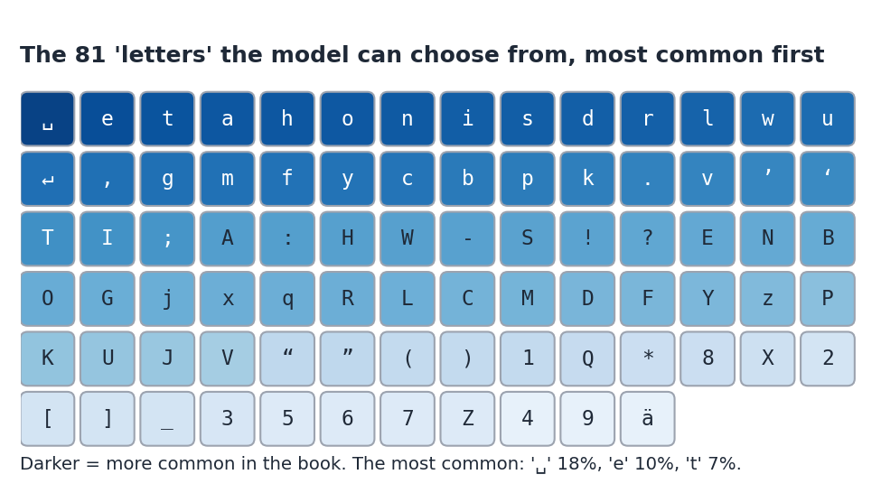
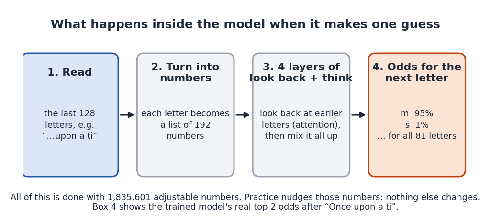
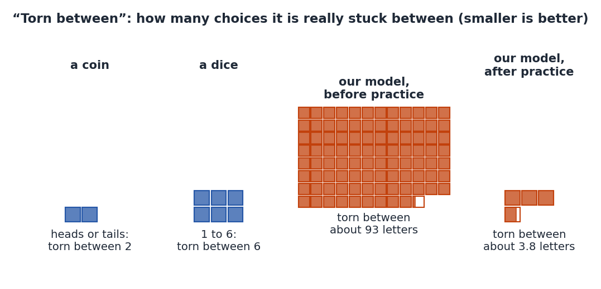
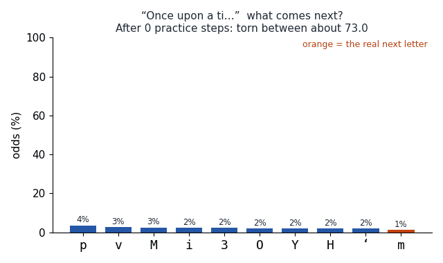
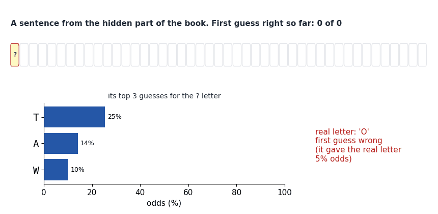
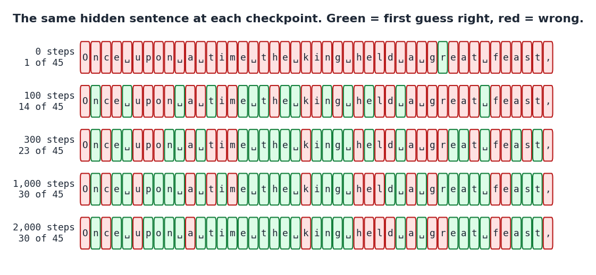
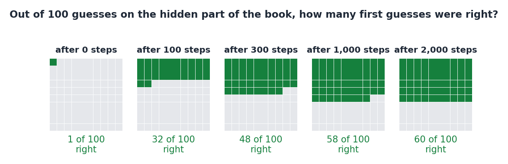
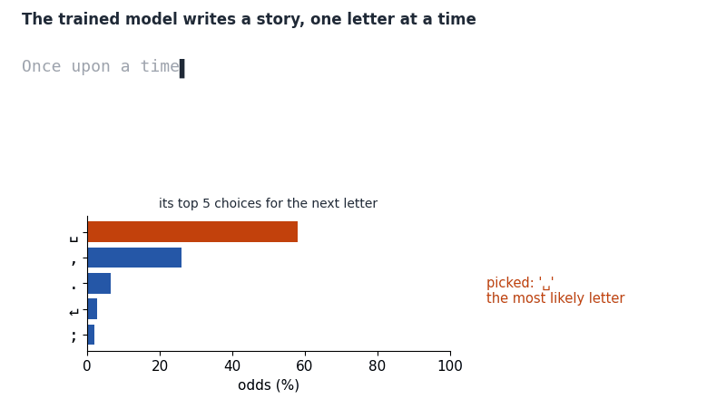
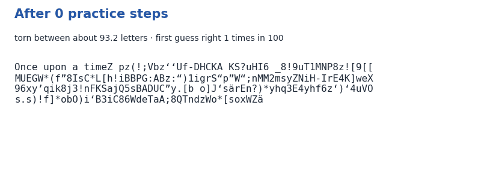
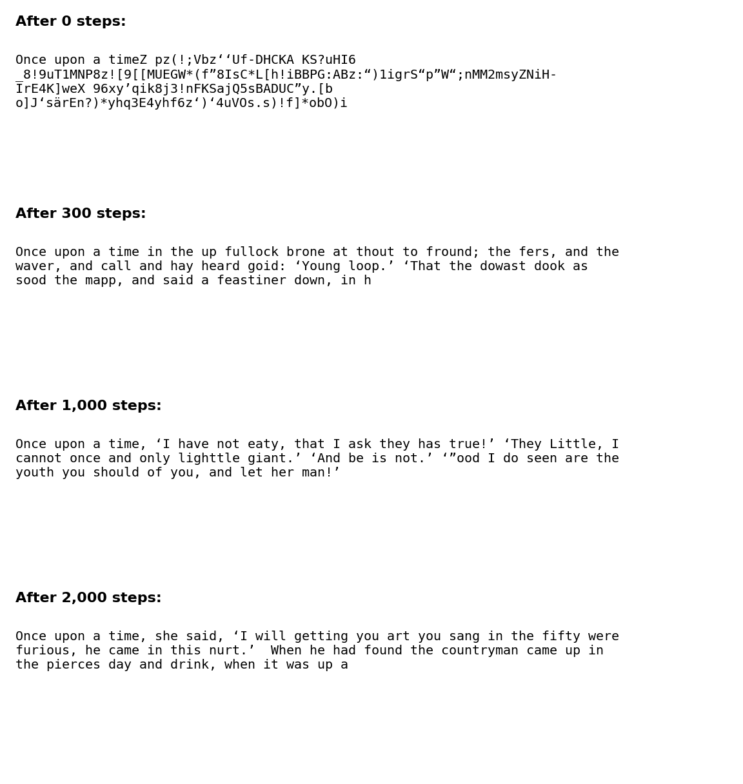

## The question

Try this. What letter comes next?

> Once upon a ti_

You probably said **m**, to make "time". You knew because you have heard lots of stories.

AI chatbots like Claude and ChatGPT do something surprisingly similar. Underneath, they play one simple game, over and over: **guess what comes next**. A scientist called Claude Shannon played this game with people in 1951. He showed them the start of a sentence and asked them to guess the next letter [@shannon1951].

So here is our question: **if a computer only ever plays this guessing game with one book, can it learn to write like that book?**

To find out, we built a tiny storyteller. We gave it a book of fairy tales and let it practise the game. Then we watched how its guesses and its writing changed.

## What we did

This section explains the whole setting, step by step. Each step has a picture.

### Step 1: the book

Our storyteller learned from one book: [Grimms' Fairy Tales](grimm.txt). It has stories like *Hansel and Gretel* and *Rumpelstiltskin*. Its first English translation is about 200 years old, so anyone may copy it.

To the computer, the book is not pages and chapters. It is **one very long line of letters**.

We cut the line into two parts:

- **The practice part** (the first 90%). The model learns from this part.
- **The hidden part** (the last 10%). The model never learns from this part. We use it like a surprise test.

> [!INTUITION]
> Imagine practising your spelling with one list of words, and then being tested on a different list. If you do well on the new list, you have learned how spelling works, not just memorised your practice list. That is why we keep part of the book hidden.

### Step 2: what counts as a "letter"

For our storyteller, a "letter" means **any single symbol** in the book. That includes capital letters, small letters, spaces, commas, quotation marks and even line breaks. The book uses {{result.alphabet_size}} different symbols in all.

Every time the model makes a guess, it must choose one of these {{result.alphabet_size}} tiles.

### Step 3: the guessing game

The game is always the same:

1. The model reads some letters of the book.
2. It guesses the **next** letter.
3. We check its guess against **the real next letter in the book**. That real letter is the right answer.

The model does not give just one guess. It gives **odds** for every possible letter. Odds tell you how likely it thinks each choice is. For example, after "Once upon a ti", a good guesser might say: "m: 95%, n: 2%, anything else: 3%". The odds for all the letters always add up to 100%.

### Step 4: inside the model

A model that guesses the next bit of text is called a **language model**. Ours is a kind called a **transformer**, the same kind used in today's chatbots [@vaswani2017].

Here is what the boxes mean:

- **It can look back 128 letters.** That is about two lines of a book. Anything further back, it cannot see.
- **Letters become numbers.** Computers only work with numbers, so each letter is turned into a list of numbers.
- **Look back and think.** In each layer, the model looks back at the earlier letters and decides which ones matter most for this guess. This looking back is called **attention**. Then it mixes everything together. It does this 4 times.
- **Odds come out.** At the end, it gives odds for every one of the {{result.alphabet_size}} letters.

All of this is done with {{result.parameters}} numbers inside the model. Think of them as {{result.parameters}} tiny knobs. When the model is brand new, the knobs are set at random, so its guesses are rubbish.

### Step 5: practice

**Practice** (scientists call it **training**) means turning those knobs a tiny bit, again and again, so that the right answers get higher odds. The computer is not "trying hard" or thinking like you. It is just adjusting numbers.

Here is one round of practice, which we call a **practice step**:

In each practice step:

1. The computer picks 64 random places in the practice part of the book.
2. From each place, it takes a stretch of 128 letters.
3. Every letter in every stretch is a guessing question. That makes 64 × 128 = 8,192 questions in one step!
4. It checks all its guesses against the real letters.
5. It turns the knobs a tiny bit, so the real letters would have got higher odds.

We did **{{result.steps}} practice steps**. That is more than 16 million guessing questions.

> [!EXAMPLE]
> It is like a spelling quiz where, after every quiz, you change your memory just a tiny bit towards the right answers. One quiz doesn't change much. Two thousand quizzes change a lot.

### Step 6: checking on the hidden part

At five moments during practice we stopped and checked the model. These moments are called **checkpoints**: after 0 steps (brand new), 100, 300, 1,000 and {{result.steps}} steps.

At each checkpoint we did three things, always on the **hidden** part of the book:

- We counted how often its **first guess** (the letter with the highest odds) was right.
- We measured how many letters it was **torn between** (explained in the next step).
- We asked it to write a story starting with "Once upon a time".

### Step 7: how we score it

The easiest score is the **first guess**. Out of 100 guesses, how many times did the letter it thought most likely turn out to be the real letter?

The second score needs a little explaining. It is called **"torn between"**. (Scientists call it **perplexity**.)

> [!INTUITION]
> If you flip a coin, you are torn between 2 answers: heads or tails. If you roll a dice, you are torn between 6. If you knew the answer for sure, you would be torn between just 1.
>
> Our score asks: on average, how many letters is the model *really* stuck between when it guesses? A model that knew nothing would be torn between all {{result.alphabet_size}} letters. A perfect model would be torn between 1.

### Where it ran

The model practised on a **GPU**, a computer chip that can do many sums at once, in a Delta cloud sandbox: a computer far away that we borrowed for a few minutes.

> [!NOTE]
> **For grown-ups.** A 4-layer, 4-head, width-192 character-level transformer with {{result.parameters}} parameters, trained for {{result.steps}} steps of AdamW (batch 64, context 128, cosine learning rate from 1e-3) on {{result.training_letters}} training characters. Perplexity is $e^{\text{loss}}$, with the cross-entropy loss measured in nats per character on random test batches. The run, including all the probes and pictures, took {{result.seconds}} seconds on an {{result.device}}. Code: [`experiment.py`](experiment.py) (training and probes) and [`pictures.py`](pictures.py) (pictures and animations). Data: [`results.csv`](results.csv), [`samples.json`](samples.json), [`probes.json`](probes.json). The writing loop:

@include experiment.py#L147-L151

## Results

### 1. Watch one guess get sharper

Let's start with a single question: what comes after "Once upon a ti"? The animation shows the model's odds at each checkpoint. The orange bar is the right answer, **m**.

- **Brand new (0 steps):** the odds are spread almost evenly. It gave **m** only about 1%. It was torn between about 73 letters.
- **After 100 steps:** it had learned which letters are common, but not this word. Its top guess was **n**, and **m** got only 7%.
- **After 300 steps:** **m** rose to 22%, but **l** was still ahead with 44%.
- **After 1,000 steps and after {{result.steps}} steps:** it gave **m** 95%. It was torn between only about 1.3 letters.

Here is the same idea for a second beginning, "The king and the qu", where the real next letter is **e** (to make "queen"):

 and after {{result.steps}} steps (right), for two beginnings. Orange is the real next letter.")

For "The king and the qu", its odds for **e** grew from under 1% to 87%. It had learned that in fairy tales a "qu" after "the king and the" is very often a queen.

### 2. Reading along with a hidden sentence

Now a whole sentence. This one comes from the **hidden** part of the book, so the model never practised on it:

> Once upon a time the king held a great feast,

We let the trained model guess each letter, one at a time, looking at all the letters before it. **Green** means its first guess was right. **Red** means it was wrong.

Here is the same sentence at every checkpoint:

Count the green tiles:

| Practice steps | First guess right (out of 45 letters) |
|---:|---:|
| 0 | 1 |
| 100 | 14 |
| 300 | 23 |
| 1,000 | 30 |
| {{result.steps}} | 30 |

Look at where it goes wrong. It can't know that the sentence starts with "O" rather than "T". It can't know the next word will be "king" or "feast". But once a word has started, like "fe", it often guesses the rest. This is just like you: guessing the next word in a story is hard, but finishing a word is easy.

### 3. The scores for the whole hidden part

One sentence could be lucky or unlucky. So we also scored the model on lots of random stretches of the hidden part.

Its first guess was right only about **1 time in 100** when brand new, about as good as guessing at random. After {{result.steps}} steps, it was right about **60 times in 100** ({{result.first_guess_right_end_pct}}%, to be exact).

Here are the "torn between" scores. Remember: smaller is better, and a perfect model would score 1.

| Practice steps | Torn between: hidden part | Torn between: practice part | Perfect score |
|---:|---:|---:|---:|
| 0 | 93.2 | 93.3 | 1 |
| 100 | 10.1 | 9.9 | 1 |
| 300 | 5.7 | 5.5 | 1 |
| 1,000 | 4.0 | 3.4 | 1 |
| {{result.steps}} | 3.8 | 2.9 | 1 |

 and the hidden part (orange). Lower is better.")

Three things to notice:

1. **Most of the learning happens early.** The biggest drop is in the first 100 steps. After that, it improves more slowly.
2. **It starts out worse than "knows nothing".** A brand-new model is torn between about 93 letters, even though there are only {{result.alphabet_size}}. That is because its random knobs make it confidently wrong about some letters, which is worse than evenly unsure.
3. **The hidden part is a little harder than the practice part.** By the end, it is torn between about 2.9 letters on pages it practised on, but about 3.8 on hidden pages. That small gap means it has started to memorise its practice pages a little.

### 4. Watching it write

To write a story, we give the model a beginning, "Once upon a time". It gives odds for the next letter. The computer **picks** a letter using those odds, a bit like spinning a spinner with bigger slices for likelier letters. We stick that letter on the end and ask again. Over and over.

Watch the orange bar. Usually the picked letter is the most likely one. But not always: in this story, 16 of the 60 letters were *not* its top choice. That is on purpose. If it always picked the top letter, it would write the same thing every time, and often get stuck repeating itself.

### 5. How its writing grew

Here is the story it wrote at each checkpoint, always starting from "Once upon a time":

The same stories, side by side:

And here is one more, from early on, after just 100 practice steps. The spelling mistakes are exactly what it wrote:

> Once upon a timer ad the foun tour llore the oust wind he ont f mor hend spin ter, lsPr the thilothithawber we heokereir t he st, f inthad ind owhe w a Tono asom wowim, w he cies!’ rand fand ble th he he fo wen ce wethithes hed hengan.

What changed along the way:

- **After 0 steps:** random letters, numbers and symbols.
- **After 100 steps:** spaces, and little words like "the", "he" and "and". Most other "words" are made up.
- **After 300 steps:** mostly real words, with commas and quotation marks.
- **After 1,000 and {{result.steps}} steps:** people talking in quotation marks, like ‘I will’, in the old-fashioned style of the book. But the sentences still don't make sense.

### 6. What does it look back at?

Remember **attention**: in each layer, the model decides which earlier letters matter most for its guess. We can peek at that.

We gave the trained model this beginning and asked for the next letter:

> Once upon a time there was a king who had a daugh_

Its guess: **t**, with almost 100% odds, to make "daughter".

Notice that it hardly looks at the beginning of the sentence. To finish "daugh", the last few letters are what matter, and all four layers look mostly at them. (Peeking inside a model like this gives clues, not a full explanation of how it thinks.)

### 7. The adventure dial

When the model writes, there is one more setting we can choose. We call it the **adventure dial**. Scientists call it **temperature**.

- **Turned down (careful):** it almost always picks its most likely letter.
- **In the middle (normal):** it usually picks likely letters, but sometimes surprises.
- **Turned up (wild):** unlikely letters get picked much more often.

All our other stories used the normal setting (0.8). Here is the same trained model, with the dial at three settings:

 set to careful (0.3), normal (0.8) and wild (1.5).")

On careful, it uses real words: "he was gone; and the saw that the witch in the house was still". On wild, it invents words like "furnifultaed" and "ChantiAlt". Neither setting makes a sensible story. The dial changes how adventurous it is, not how much it understands.

> [!TAKEAWAY]
> By playing one guessing game with one book, {{result.steps}} times, a tiny model learned a lot by itself. It learned spelling, common words, punctuation and the style of a fairy tale. On pages it had never seen, its first guess went from right about 1 time in 100 to about 60 times in 100. But it never learned to tell a story that makes sense.

## What this does and doesn't show

**It learned patterns, not just pages.** It guessed well on the hidden part of the book, which it never practised on. So it learned general patterns of the book.

**It does not understand stories.** Its stories sound like fairy tales, but characters appear and disappear and nothing really happens. Good guessing is not the same as understanding.

**It is tiny.** It has {{result.parameters}} knobs and read one book. Real chatbots have hundreds of billions of knobs, read huge amounts of text, and get extra training to be helpful and safe. Our experiment shows *how* they learn, not how good they are.

**Letters, not words.** Real chatbots guess chunks of text called **tokens**, which are often whole words or parts of words. We used single letters because they are easier to see.

**One run.** We trained it once, starting from one set of random knobs. Another run would write different stories. We did not check how different its scores would be.

**Old-fashioned English.** The book is an old translation, so the storyteller writes in that old-fashioned style.

## Try it yourself

You can play Shannon's game with a friend. Pick a sentence from a book. Show your friend one letter at a time, and before each letter, ask them to guess it. Count how many first guesses they get right. You will probably find what our storyteller found: the first letter of a word is hard, and the rest of the word is easy!
